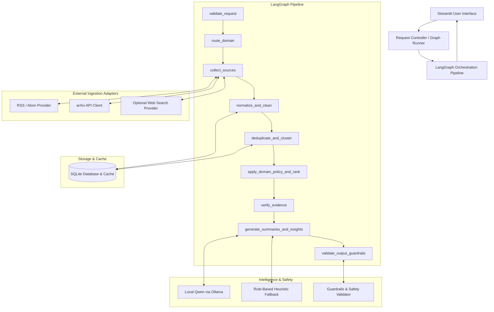
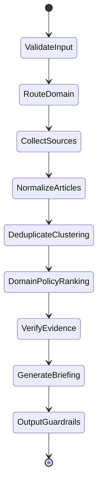

# System Design & Architecture
# AI News & Research Agent

## 1. System Overview & Architecture Diagram
The AI News & Research Agent orchestrates end-to-end multi-source intelligence gathering across three specialized domains: **Cricket News**, **Geopolitics**, and **AI News & Research**.

The system is designed with a layered, decoupled architecture:
1. **Source Layer**: Adapter-based fetchers (RSS, arXiv API, optional Web Search) registered in a declarative Source Registry.
2. **Ingestion & Normalization Layer**: URL validation, SSRF filtering, HTML cleanup, date parsing, and canonical deduplication.
3. **Domain Policy & Filtering Layer**: Domain-specific heuristics ensuring strict adherence to editorial criteria (e.g., rejecting routine cricket scorecards, scoring geopolitical impact, verifying AI model releases).
4. **LangGraph Workflow Orchestration**: StateGraph managing state, conditional routing, multi-factor scoring, verification, and summarization.
5. **Dual-Path Intelligence Engine**: Ollama (Qwen local LLM) for structured semantic extraction with transparent, zero-hallucination heuristic fallback when local LLM is offline.
6. **Persistence Layer**: SQLite for relational metadata, caching with TTL, and deduplication fingerprints.
7. **Presentation Layer**: Streamlit dashboard with dedicated domain tabs, source health telemetry, and full audit provenance.



---

## 2. Component Responsibilities & Directory Layout
```
ai-news-research-agent/
│
├── app/
│   ├── main.py                  # CLI entrypoint & service initialization
│   ├── config.py                # Environment & settings configuration (Pydantic Settings)
│   ├── agents/
│   │   ├── router.py            # High-level domain intent handler
│   │   ├── cricket_agent.py     # Cricket domain policy & filter logic
│   │   ├── geopolitics_agent.py # Geopolitics domain policy & India-impact logic
│   │   └── ai_news_agent.py     # AI research & model launch analysis logic
│   ├── graph/
│   │   ├── state.py             # LangGraph AgentState TypedDict
│   │   ├── nodes.py             # Pure functional graph nodes
│   │   ├── routing.py           # Conditional edge routing rules
│   │   └── workflow.py          # StateGraph compilation & execution
│   ├── sources/
│   │   ├── base.py              # BaseSourceAdapter abstract base class
│   │   ├── source_registry.py   # Registry containing trusted feeds & configurations
│   │   ├── rss_reader.py        # Resilient RSS/Atom fetcher with timeouts & parsing
│   │   ├── web_search.py        # Pluggable external search provider interface
│   │   ├── article_extractor.py # Safe HTML extraction & content parsing (BeautifulSoup)
│   │   ├── cricket_sources.py   # Cricket-specific feeds & endpoint definitions
│   │   ├── geopolitics_sources.py # Geopolitics-specific feeds & endpoint definitions
│   │   └── ai_research_sources.py # arXiv API adapter & AI lab release feeds
│   ├── services/
│   │   ├── llm.py               # Ollama client wrapper with availability detection
│   │   ├── normalization.py     # Content cleanup, date standardization, sanitization
│   │   ├── deduplication.py     # Title & fingerprint similarity clustering
│   │   ├── news_ranker.py       # Multi-factor scoring engine
│   │   ├── source_verifier.py   # URL, status, and domain trust validation
│   │   ├── research_analyzer.py # arXiv paper extraction & structured analysis
│   │   └── report_generator.py  # Structured briefing generation with fallback
│   ├── guardrails/
│   │   ├── input_guardrails.py  # User input validation & sanitization
│   │   ├── prompt_injection.py  # Defense against embedded prompt injections
│   │   ├── tool_guardrails.py   # SSRF defense, URL safelist, timeout enforcement
│   │   ├── source_validation.py # Source domain, freshness, and status validation
│   │   ├── fact_checking.py     # Claim-to-source provenance & uncertainty tagging
│   │   └── output_guardrails.py # Final output validation & leak prevention
│   ├── schemas/
│   │   ├── article.py           # NormalizedArticle, RawArticle, ExtractedPaper
│   │   ├── source.py            # SourceConfig, SourceHealth, TrustLevel
│   │   └── briefing.py          # NewsBriefing, NewsCard, GeopoliticsCard, etc.
│   └── storage/
│       ├── database.py          # SQLite connection manager & schema migrations
│       └── repository.py        # Article and cache CRUD repository
│
├── frontend/
│   └── streamlit_app.py         # Multi-tab Streamlit dashboard
├── scheduler/
│   └── daily_briefing.py        # CLI/Cron background briefing generator
├── docs/                        # Mandatory project documentation
├── tests/                       # Pytest test suite (unit, integration, guardrails)
├── requirements.txt
├── .env.example
└── README.md
```

---

## 3. LangGraph Workflow & State Model

### 3.1 State Definition (`AgentState`)
The state is managed as an immutable dictionary adhering to LangGraph conventions:
```python
class AgentState(TypedDict):
    domain: str                     # "cricket", "geopolitics", "ai_news"
    category_filter: Optional[str]  # e.g., "test_cricket", "new_papers", etc.
    time_window_hours: int          # default 48
    query: Optional[str]            # optional search/filter term
    raw_articles: List[RawArticle]
    normalized_articles: List[NormalizedArticle]
    clustered_stories: List[StoryCluster]
    ranked_stories: List[RankedStory]
    briefing: Optional[NewsBriefing]
    errors: List[str]
    source_statuses: Dict[str, str]
    execution_metadata: Dict[str, Any]
```

### 3.2 State Flow


---

## 4. Multi-Factor Importance Ranking Engine
Each story is evaluated using an explainable composite function:
$$S = w_{\text{rel}} \cdot S_{\text{rel}} + w_{\text{impact}} \cdot S_{\text{impact}} + w_{\text{rec}} \cdot S_{\text{rec}} + w_{\text{src}} \cdot S_{\text{src}} + w_{\text{corrob}} \cdot S_{\text{corrob}}$$

| Factor | Weight | Description |
|---|---|---|
| **Relevance ($S_{\text{rel}}$)** | 0.25 | Relevance to selected domain and category criteria. |
| **Impact ($S_{\text{impact}}$)** | 0.30 | Magnitude of the event (e.g. historic record, geopolitical escalation, major model weights release). |
| **Recency ($S_{\text{rec}}$)** | 0.20 | Exponential decay based on hours since publication: $e^{-\lambda \Delta t}$. |
| **Source Quality ($S_{\text{src}}$)** | 0.15 | Assigned trust score based on Source Registry (Official: 1.0, High: 0.85, Standard: 0.7). |
| **Corroboration ($S_{\text{corrob}}$)** | 0.10 | Cluster size representing independent multi-outlet corroboration. |

### Domain-Specific Adjustments:
- **Cricket**: Penalizes routine scores with negative weights; rewards keywords like *record, historic margin, series win, retirement, upset*.
- **Geopolitics**: Elevates security treaties, military developments, UN/diplomatic sanctions, and direct India bilateral engagements. Limits final display to top 5.
- **AI Research**: arXiv papers receive baseline verified academic scores; frontier model launches require verified release URLs. Limits final display to top 5.

---

## 5. Intelligence Engine: Ollama / Qwen Integration & Graceful Fallback
1. **Ollama Integration**: Connects via `httpx` to `http://localhost:11434` (configurable via `OLLAMA_BASE_URL`).
2. **Model Flexibility**: Defaults to `qwen2.5:7b` (configurable via `OLLAMA_MODEL`).
3. **Availability Detection**: Performs a health check (`/api/tags`) at graph initialization.
4. **Graceful Fallback**: If Ollama is unreachable:
   - Does NOT fail or display mock data.
   - Activates `RuleBasedHeuristicAnalyzer`.
   - Extracts structured claims, executive summaries, lead paragraphs, and key sentences directly from retrieved text.
   - Tags the output with `analysis_mode="heuristic_fallback"`.

---

## 6. Guardrails & Security Architecture
- **Tool / SSRF Guardrail**: Blocks requests to RFC 1918 addresses, loopbacks (`127.0.0.1`), link-local (`169.254.169.254`), and non-HTTP/HTTPS protocols.
- **Prompt Injection Defense**: Sanitizes input strings, escapes XML/JSON brackets, strips dangerous instructional delimiters (`[INST]`, `<|im_start|>`), and treats all scraped HTML as untrusted data blocks.
- **Factuality & Citation Guardrail**: Guarantees every claim links to a verified retrieved canonical URL. Blocks output generation of unsubstantiated claims.
