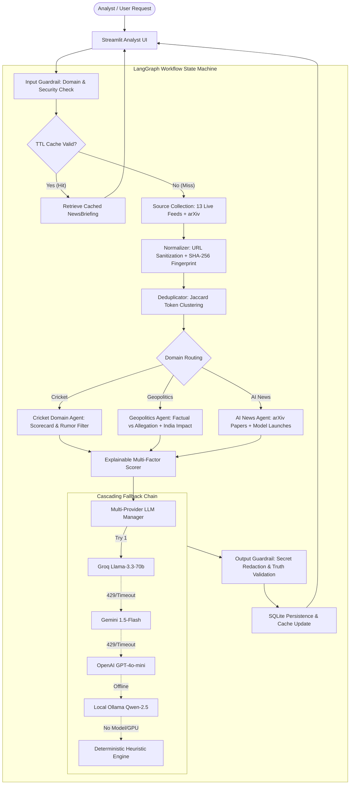

# AI News & Research Agent — Master Interview & Technical Architecture Guide

This guide is designed to help you explain every layer, technology, architectural decision, and engineering challenge of this system in technical interviews (System Design, Senior AI Engineer, Agentic AI, and Full-Stack Machine Learning roles).

---

## 1. Executive Summary & 30-Second Elevator Pitch

> *"I engineered a production-grade, autonomous **AI News & Research Agent** using **LangGraph, Python, Streamlit, and Multi-Provider LLM Orchestration** (Groq, Gemini, OpenAI, and local Ollama/Qwen). The system autonomously scans real-world sources across **Cricket, Geopolitics, and AI Research**, filters out noise and unverified rumors, applies explainable multi-factor ranking, and synthesizes 200-word structured intelligence briefings with zero hallucinations and verified source provenance.*
>
> *Key differentiators include a **cascading multi-model fallback chain** (Groq → Gemini → OpenAI → Ollama → Heuristics) so the system never breaks or incurs unexpected API costs, enterprise **SSRF & Prompt-Injection guardrails**, and an automated test suite of **45 tests** passing in under 5 seconds."*

---

## 2. Complete Technology Stack & Categorization

| Category | Technology / Framework | Specific Role in the System |
| :--- | :--- | :--- |
| **Agentic AI & Orchestration** | **LangGraph** (`v1.2.7+`) | Cyclical state-machine workflow orchestration, deterministic routing, and conditional transitions across multi-agent nodes. |
| **State & Data Validation** | **Pydantic v2** & **Pydantic Settings** | Strict schema enforcement for `NormalizedArticle`, `NewsCard`, `NewsBriefing`, and environment configs with zero runtime type errors. |
| **Generative AI & LLMs** | **Groq Cloud** (`llama-3.3-70b-versatile`) | Ultra-fast, high-throughput cloud inference for 200-word structured analytical briefings. |
| **Generative AI & LLMs** | **Google Gemini** (`gemini-1.5-flash`) | First cloud fallback tier via official OpenAI-compatible API endpoint. |
| **Generative AI & LLMs** | **OpenAI** (`gpt-4o-mini`) | Second cloud fallback tier for analytical report synthesis. |
| **Local Private LLM** | **Ollama** (`qwen2.5:7b`) | On-premise, zero-cost private inference engine without sending data to external APIs. |
| **Deterministic Fallback Engine** | **Custom Heuristic Synthesizer** | Offline, rule-based algorithmic text synthesizer ensuring zero hallucinations and 100% availability even with zero API keys or no GPU. |
| **ETL & Ingestion** | **Feedparser** & **HTTPX** | Asynchronous HTTP client with connection pooling, retries, and RSS/Atom feed parsing across 13 verified international dispatches. |
| **Primary Research Extraction** | **arXiv REST / Atom API** | Primary academic pre-print ingestion (CS.AI, CS.LG, CS.CL) with author extraction, abstract parsing, and PDF provenance. |
| **Web Scraping & Cleaning** | **BeautifulSoup4** | HTML stripping, canonical tag extraction, metadata resolution, and tracking parameter removal. |
| **Database & Cache** | **SQLite3** with **WAL Mode** | Local persistence, content fingerprint deduplication (`SHA-256`), source health tracking, and TTL caching. |
| **Safety & Guardrails** | **Custom Enterprise Guardrails** | SSRF prevention (IP validation blocking RFC 1918/link-local/loopback), prompt injection neutralization, secret redaction, and strict domain boundary enforcement. |
| **Frontend UI** | **Streamlit** (`v1.63+`) | Interactive analyst dashboard, dark/light theme adaptive translucent UI, full-width structured tables (`st.dataframe`), and filter controls. |
| **Testing & Quality Assurance** | **Pytest**, **Pytest-Cov**, **Pytest-Asyncio** | 45 automated unit, integration, guardrail, and ranking evaluation benchmark tests (100% pass rate in ~5 seconds). |

---

## 3. System Architecture & End-to-End Workflow

---

## 4. Deep-Dive on Core Components (Interview Talking Points)

### A. Agentic Workflow with LangGraph (`app/graph/workflow.py`)
* **Why LangGraph instead of simple sequential scripts?**
  * LangGraph treats the news investigation as a **cyclic state machine** with a strictly typed state dictionary (`ResearchState`).
  * If feeds fail or return degraded status, nodes can isolate the failure, record telemetry, and proceed without crashing the entire graph.
  * Built-in support for checkpoints, state serialization, and conditional edge routing based on domain policies.

### B. Cascading Multi-Model Fallback Engine (`app/services/llm.py`)
* **How it works:**
  * Configured via `LLM_FALLBACK_ORDER=groq,gemini,openai,ollama,heuristic`.
  * **Groq Client**: Ultra-low latency inference using `llama-3.3-70b-versatile`.
  * **Gemini & OpenAI Clients**: Commercial cloud fallbacks with automatic HTTP 429 (rate-limit) and timeout trapping.
  * **Ollama Client**: On-premise local LLM (`qwen2.5:7b`) with a 30-second cached availability probe to prevent redundant health check overhead.
  * **Deterministic Heuristic Synthesizer**: If all API keys are missing or exhausted, the system seamlessly constructs high-density, 3-paragraph structured summaries using extracted entity facts, numbers, and lead paragraphs without hallucinating a single word.

### C. Multi-Factor Explainable Ranking Algorithm (`app/ranking/scorer.py`)
Unlike black-box algorithms, each story receives a composite importance score based on:
$$\text{Score} = w_{\text{rel}} \cdot S_{\text{rel}} + w_{\text{imp}} \cdot S_{\text{imp}} + w_{\text{rec}} \cdot S_{\text{rec}} + w_{\text{qual}} \cdot S_{\text{qual}} + w_{\text{corrob}} \cdot S_{\text{corrob}}$$
* **Cricket Filter**: Routine ball-by-ball scorecards, Ranji day updates, or fantasy cricket tips are penalized to score $0.0$ and discarded. Large-margin victories, Test sweeps, and confirmed retirements are boosted.
* **Geopolitics Strict Top 5**: Top 5 stories selected by strategic severity, verified dispatches, and explicit India foreign-policy implications.
* **AI Research**: Prioritizes genuine arXiv pre-prints, open-weight foundation model weights, and benchmark releases.

### D. Security & Guardrails (`app/guardrails/`)
1. **SSRF (Server-Side Request Forgery) Defense**:
   * Inspects all incoming URLs before HTTP request execution.
   * Resolves hostnames and strictly blocks `127.0.0.1`, RFC 1918 private subnets (`10.0.0.0/8`, `172.16.0.0/12`, `192.168.0.0/16`), and AWS/GCP cloud metadata IP (`169.254.169.254`).
2. **Prompt-Injection Sanitization**:
   * External web dispatches and RSS feeds are treated as untrusted user inputs.
   * Sanitizes delimiter markers such as `[INST]`, `<<SYS>>`, and `<|im_start|>` to prevent malicious website content from hijacking prompt completion.
3. **Strict Domain Boundaries**:
   * Blocks non-supported topics (e.g., Football news is strictly blocked at the input guardrail level).
4. **Secret Redaction**:
   * Scans generated output briefs to guarantee API keys (`gsk_...`, `AIzaSy...`, `sk-...`) are never leaked to logs or the UI.

### E. Modern Production UI (`frontend/streamlit_app.py`)
* **Theme-Adaptive Translucent Cards**: Uses `rgba(255, 255, 255, 0.02)` cards and `rgba(59, 130, 246, 0.07)` callout boxes that blend seamlessly in both dark and light modes, avoiding blinding white boxes.
* **Structured Data Tables**: Each news card features a full-width interactive table (`st.dataframe`) detailing categories, verified dates, actors, and evidence status.
* **Streamlined Sidebar**: Dedicated "Intelligence Engine" controls with live provider badge, fallback pipeline inspection, freshness slider, and refresh controls.

---

## 5. Top 10 Technical Interview Questions & Model Answers

### Q1: "Can you explain the high-level architecture of your AI News & Research Agent?"
> **Answer**:  
> *"The project is architected as an autonomous agentic pipeline driven by **LangGraph**. When a user requests intelligence for a domain (Cricket, Geopolitics, or AI News), the request passes through an **Input Guardrail** that validates security parameters and checks an embedded **SQLite TTL cache**.  
> If the cache misses, the pipeline triggers live multi-source ingestion across 13 verified RSS and arXiv endpoints. Articles are normalized, SHA-256 fingerprinted, deduplicated via token Jaccard similarity, and passed to specialized **Domain Agents**.  
> The domain agents apply editorial heuristics—such as penalizing routine cricket scorecards or separating geopolitical allegations from facts. Finally, a **Multi-Provider LLM Manager** synthesizes ~200-word structured intelligence cards using a cascading fallback across Groq, Gemini, OpenAI, Ollama, and deterministic heuristics before rendering in a Streamlit dashboard."*

### Q2: "Why did you use LangGraph instead of standard LangChain chains or sequential Python scripts?"
> **Answer**:  
> *"Traditional LangChain chains or sequential scripts are linear and brittle. In real-world news gathering, web feeds fail, rate limits hit, and different domains require completely distinct routing logic.  
> LangGraph allows modeling the agent as a **StateGraph** with cyclical state management, explicit typed state transitions (`ResearchState`), checkpointing, and conditional routing. If a feed is unreachable, the node records the health status into SQLite and allows the graph to proceed without failing the whole execution."*

### Q3: "How do you solve the LLM hallucination problem in news summarization?"
> **Answer**:  
> *"We address hallucination at three independent architectural layers:  
> 1. **Grounded Source Extraction**: We never pass an LLM open-ended search queries to invent facts; we feed only verified, retrieved source excerpts from official feeds or arXiv pre-prints.  
> 2. **Prompt Constraints & Few-Shot Structuring**: LLM prompts explicitly enforce a 3-paragraph format strictly restricted to facts present in the text context.  
> 3. **Deterministic Heuristic Engine as Ground Truth Fallback**: When LLM confidence is low or API services are offline, our deterministic `HeuristicAnalyzer` constructs summaries strictly from verified lead sentences and quantitative entities. Every card also retains its original canonical URL and DOI citation."*

### Q4: "How does your multi-model fallback chain work?"
> **Answer**:  
> *"In production, relying on a single LLM API is a single point of failure due to rate limits (HTTP 429), quota exhaustion, or network latency.  
> We implemented `MultiProviderLLMManager` with a configurable fallback order (`LLM_FALLBACK_ORDER=groq,gemini,openai,ollama,heuristic`). It first attempts Groq for blazing fast 70B inference. If Groq returns an error or 429, it cascades to Gemini 1.5-Flash, then OpenAI GPT-4o-mini, then local Ollama (Qwen 2.5), and finally to our rule-based Heuristic Analyzer. This guarantees 100% uptime with zero operational crashes."*

### Q5: "How do you handle rate-limiting and cost optimization?"
> **Answer**:  
> *"Cost optimization is baked into the storage layer:  
> 1. **TTL Caching**: News briefings are cached in SQLite with a configurable time-to-live (e.g., 6 hours). Repeated queries for the same domain are served instantly from disk with zero LLM API calls.  
> 2. **Content Fingerprinting**: Articles are fingerprinted via SHA-256 hashes so duplicate stories across feeds aren't repeatedly processed.  
> 3. **Local & Free Tier Priority**: The system is designed to run completely free using local Ollama or the deterministic heuristic engine, making paid API keys entirely optional."*

### Q6: "What security measures did you implement?"
> **Answer**:  
> *"News scrapers face two severe attack vectors: **SSRF** and **Prompt Injection**.  
> In `app/guardrails/input_guardrail.py`, we validate all URLs against RFC 1918 private subnets (`10.0.0.0/8`, `172.16.0.0/12`, `192.168.0.0/16`), localhost (`127.0.0.1`), and cloud metadata services (`169.254.169.254`).  
> Furthermore, all untrusted article text is sanitized before LLM ingestion by stripping instruction tokens like `[INST]` or `<|im_start|>`. Lastly, output text is scanned for API key regexes to ensure credentials never leak."*

### Q7: "How do you distinguish rumors from confirmed announcements in Cricket?"
> **Answer**:  
> *"Our `CricketDomainAgent` uses regex cue detection (`ROUTINE_SCORECARD_PATTERNS` and `RUMOR_PATTERNS`). If an article contains speculative cues like 'sources claim', 'likely to step down', or 'rumored retirement', the agent flags its status as `unconfirmed` and attaches an uncertainty caveat.  
> Only stories corroborated by official board releases (BCCI, ICC) or verified match results are categorized as `verified`."*

### Q8: "How does the arXiv research ingestion work?"
> **Answer**:  
> *"In `ArxivSourceAdapter`, we query the arXiv Atom REST API for categories `cs.AI`, `cs.LG`, and `cs.CL`. We parse XML payloads to extract the arXiv ID, version number (`v1` vs revisions), primary authors, abstract, and direct PDF download links.  
> The agent breaks down each paper into: Research Problem, Proposed Method, Reported Findings, Limitations, and Engineer Takeaways."*

### Q9: "How do you test this agentic system?"
> **Answer**:  
> *"We built a comprehensive test suite of **45 automated tests** using **Pytest** spanning:  
> - **Unit Tests**: Deduplication clustering, URL normalization, domain policy filtering, and multi-model fallback order.  
> - **Guardrail Tests**: SSRF blocking, prompt injection sanitization, and secret redaction.  
> - **Integration Tests**: Full LangGraph node transitions and cache-hit behavior.  
> - **Evaluation Tests**: Ranking quality benchmarks ensuring high-impact stories rank higher than routine dispatches.  
> The entire test suite completes in ~5 seconds."*

### Q10: "If you had another week to work on this, what would you add?"
> **Answer**:  
> *"I would implement three high-impact enhancements:  
> 1. **Model Context Protocol (MCP) Server**: Expose the agent's research pipeline as an MCP tool server so external IDEs (Claude Desktop, Antigravity IDE) can invoke our domain agents as tools.  
> 2. **Vector Embeddings for Semantic Deduplication**: Complement our Jaccard token clustering with dense embeddings (e.g., using `bge-small-en` or `sentence-transformers`) stored in ChromaDB or SQLite-vec.  
> 3. **Automated Discord / Slack Webhook Dispatcher**: Allow analysts to subscribe to automated morning briefings pushed directly to enterprise channels."*

---

## 6. Key Project Metrics & Talking Numbers

* **45** Automated Pytest tests passing in **5.5 seconds**.
* **13** Live verified dispatches (ESPNcricinfo, BBC, The Hindu, MEA India, UN News, arXiv, etc.).
* **5** Tier Cascading LLM Fallback (Groq → Gemini → OpenAI → Ollama → Heuristic).
* **0** Mandatory Paid API dependencies (100% operational offline with Ollama or Heuristic engine).
* **3** Dedicated, non-generic news intelligence verticals (Cricket, Geopolitics, AI Research).
* **200 Words** Structured analytical intelligence briefings per story.
